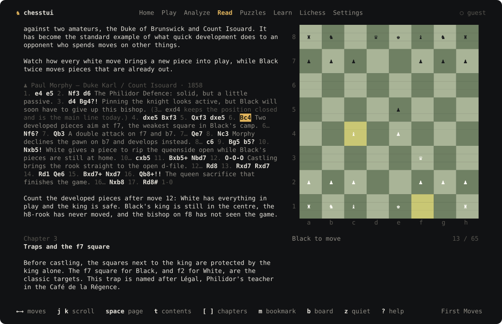
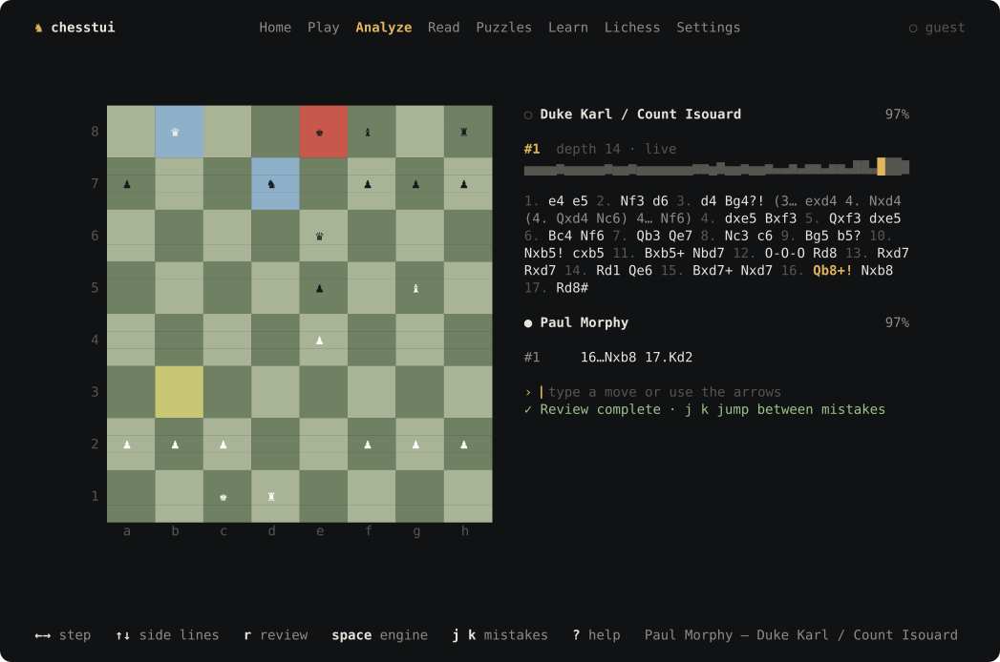
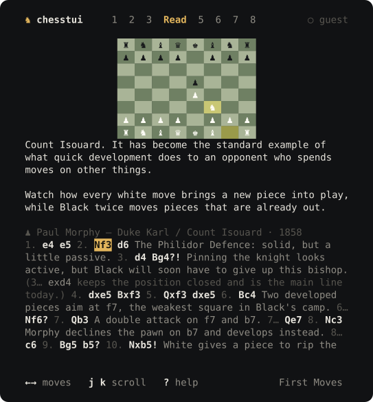

<p align="center">
  
</p>

<h1 align="center">chesstui</h1>

<p align="center">Chess in the terminal. Play your engine, review your games, and read chess books in a split while you work.</p>

<p align="center">
  <a href="https://github.com/kannachi323/chesstui/actions/workflows/ci.yml"></a>
  <a href="https://github.com/kannachi323/chesstui/releases"></a>
  <a href="LICENSE"></a>
</p>

## Features

- **Play** against your own engine at eight strengths, as white, black or random. Every game is saved as PGN after each move, and you can take moves back or resume later.
- **Analyze** any game you played, imported or pasted.
  - The engine reviews every move and draws an evaluation graph.
  - Inaccuracies, mistakes and blunders are marked, with an accuracy score per player.
  - Live engine analysis shows the top three lines.
  - Try side lines, write comments, and copy or export the PGN.
- **Read** chess books in annotated PGN or Markdown.
  - The board follows the move you're reading.
  - Contents, bookmarks and your last position are saved.
  - Works in a 60-column split, and a quiet mode hides everything but the page.
  - Includes a short starter book.
- **Puzzles** from imported [Lichess puzzle packs](https://database.lichess.org/#puzzles), and **Learn** with short interactive lessons.
- **Lichess (beta)**:
  - Watch TV.
  - Copy any public player's games into your library, or save a study as a book.
  - Play online.
  - Switch the whole tab off in Settings.

Type moves (`e4`, `Nf3`, `O-O`, `e7e8q`) or walk the board with the arrow keys. Press `?` on any screen for its keys.

| | |
|---|---|
|  |  |
|  |  |

## Install

Download an archive for macOS, Linux or Windows from [Releases](https://github.com/kannachi323/chesstui/releases), unpack it, and put `chesstui` on your `PATH`.

From source (Go 1.26 or later):

```sh
git clone https://github.com/kannachi323/chesstui && make -C chesstui build
./chesstui/build/chesstui
```

### Engine

chesstui has no engine of its own. It talks UCI to the one you already have:

- If [Stockfish](https://stockfishchess.org) is installed (`brew install stockfish`, or your distribution's package), chesstui finds it on its own.
- To use another UCI engine, such as Lc0, set its path in **Settings → Engine**.
- Threads, memory and analysis depth are set there too.

Each turn, the engine gets the starting position and the full move list, so it sees the whole game.

Without an engine you can still read, replay games, explore lines by hand, and solve puzzles.

## Books

A book is an annotated PGN file, where every game is a chapter, or a Markdown file:

````markdown
# My Openings
by Me

## The Italian

Prose wraps to the terminal width.

```pgn
1. e4 e5 2. Nf3 Nc6 3. Bc4 {The bishop eyes f7.} (3. Bb5 {is the Spanish.}) 3... Bc5 *
```

```fen
r1bqk1nr/pppp1ppp/2n5/2b1p3/2B1P3/5N2/PPPP1PPP/RNBQK2R w KQkq - 4 4
White to move.
```
````

Open a book with **Read → o**, or drop it into the books folder; **Settings** shows where the library lives. A Lichess study saved from the beta tab becomes a book automatically.

## Keys

| Key | |
|---|---|
| `1`–`8` | Home, Play, Analyze, Read, Puzzles, Learn, Lichess, Settings |
| `H` `L`, `gt` `gT` | previous / next section |
| `tab`, `esc` | focus the tab bar |
| `:` | commands, e.g. `:read`, `:q` |
| `?` | help for the current screen |
| `q` | quit; asks again during a live online game |

## Data

Config, the SQLite library (games, analysis, books, puzzles) and logs live in your platform's standard folders, and **Settings** shows the exact paths. The theme follows your terminal's background; set `"theme": "dark"` or `"light"` in the config to choose one.

A Lichess sign-in, used only by the beta tab, goes in your OS keychain. Where there is no keychain, it goes in a private `0600` file. See [SECURITY.md](SECURITY.md).

## Development

```sh
make test      # unit, render and end-to-end tests (a fake UCI engine stands in for Stockfish)
make race vet
make shots     # regenerate docs/screenshots and the site's frames from the real UI
make live      # smoke-test the real lichess.org API (about eight requests)
```

- The app is the Go module in [`chesstui/`](chesstui). See [Architecture](docs/ARCHITECTURE.md), the [Roadmap](docs/ROADMAP.md) and [Releasing](docs/RELEASE.md).
- The landing page in [`web/`](web) builds with `npm run build --prefix web`.
- The original C version is in [`legacy/`](legacy).

## License

Apache-2.0. Engines are separate programs that you install yourself. chesstui is not affiliated with Lichess.
