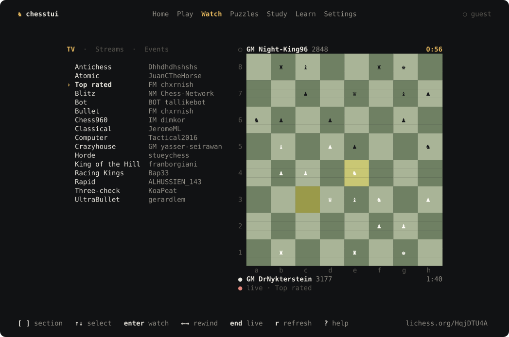
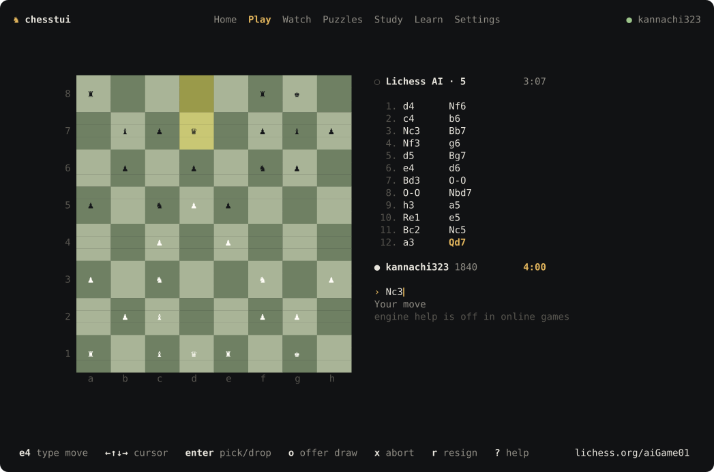
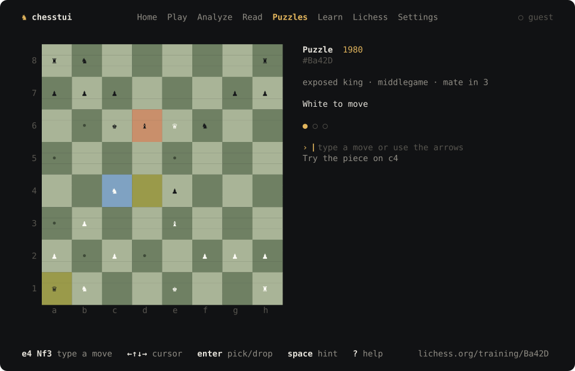
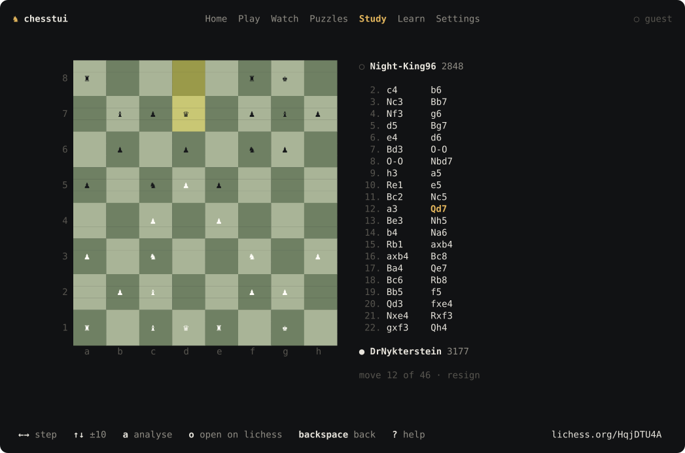
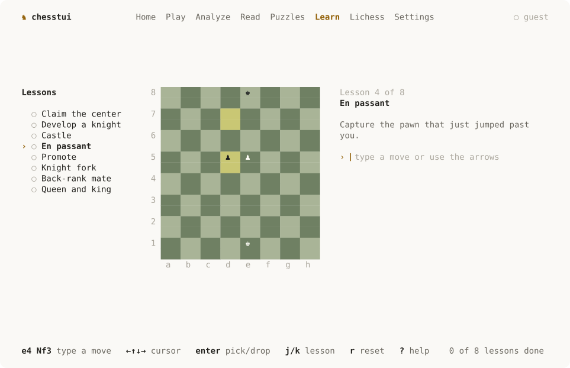

<p align="center">
  
</p>

<h1 align="center">chesstui</h1>

<p align="center">Chess in the terminal. Play, watch and train on Lichess from your shell.</p>

<p align="center">
  <a href="https://github.com/kannachi323/chesstui/actions/workflows/ci.yml"></a>
  <a href="https://github.com/kannachi323/chesstui/releases"></a>
  <a href="LICENSE"></a>
</p>

## Features

- **Play**: Lichess AI (levels 1–8), challenge a friend, or play Stockfish offline, as white, black or random. Live clocks, draw offers, abort and resign.
- **Watch**: every Lichess TV channel, rendered natively, with rewind. Streams and broadcasts open in your browser.
- **Train**: the daily puzzle, more from Lichess, or millions offline from an imported [puzzle pack](https://database.lichess.org/#puzzles).
- **Study**: open any public player's games and studies, replay move by move, and analyse with local Stockfish.
- **Learn**: short interactive lessons, from the first pawn move to back-rank mate.

Enter moves by typing them (`e4`, `Nf3`, `O-O`, `e7e8q`) or by walking the board with the arrow keys. Press `?` for every key.

| | |
|---|---|
|  |  |
|  |  |

## Install

Download an archive for macOS, Linux or Windows from [Releases](https://github.com/kannachi323/chesstui/releases), unpack it, and put `chesstui` on your `PATH`.

From source (Go 1.26+):

```sh
git clone https://github.com/kannachi323/chesstui && make -C chesstui build
./chesstui/build/chesstui
```

Optional: install [Stockfish](https://stockfishchess.org) for offline games and analysis (`brew install stockfish`, or your distribution's package).

## Lichess account

Watching, puzzles, study and lessons need no account. To play on Lichess, open **Play → Lichess account**. Approve chesstui in your browser and you are signed in. Your password never passes through the app.

The token is kept in your OS keychain, or in a private `0600` file where no keychain exists. Signing out from **Settings** revokes it on Lichess. Stockfish is never available in an online game. See [SECURITY.md](SECURITY.md).

## Keys

| Key | |
|---|---|
| `1`–`7` | Home, Play, Watch, Puzzles, Study, Learn, Settings |
| `H` `L`, `gt` `gT` | previous / next section |
| `tab`, `esc` | focus the tab bar |
| `:` | commands: `:watch`, `:puzzles`, `:q` |
| `?` | help for the current screen |
| `q` | quit |

## Data

Config, the SQLite library (puzzles, attempts, games, analysis) and logs live in your platform's standard folders. **Settings** shows the exact paths. The theme follows your terminal's background; set `"theme": "dark"` or `"light"` in the config to force one.

## Development

```sh
make test      # unit, render and end-to-end tests against a fake Lichess
make race vet
make shots     # regenerate docs/screenshots and the site's frames from the real UI
make live      # smoke-test the real lichess.org API (about eight requests)
```

- The app is the Go module in [`chesstui/`](chesstui). See [Architecture](docs/ARCHITECTURE.md) and [Releasing](docs/RELEASE.md).
- The landing page in [`web/`](web) builds with `npm run build --prefix web` and is deployed by Vercel from the repository root.
- The original C version is in [`legacy/`](legacy).

## License

Apache-2.0. Stockfish is a separate GPL program found at runtime, not bundled. chesstui uses the [Lichess API](https://lichess.org/api) and is not affiliated with Lichess.
