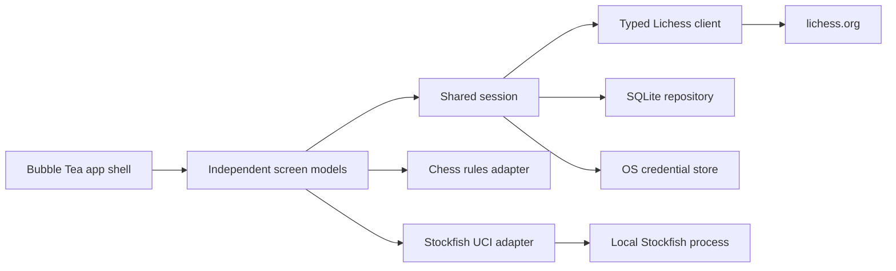

# ChessTUI architecture

ChessTUI is a single local process. Bubble Tea owns UI state and dispatches typed messages; screens depend on a shared session containing configuration, the Lichess client, the credential abstraction, and SQLite storage.

## Package boundaries

- `cmd/chesstui`: composition root, logging, process lifecycle.
- `internal/app`: global navigation, window layout, asynchronous message routing.
- `internal/ui/screens`: small, stateful Bubble Tea screen models.
- `internal/ui/widgets` and `theme`: reusable rendering with no network or persistence work.
- `internal/lichess`: endpoint-specific typed API methods, OAuth PKCE, NDJSON streams, rate-limit handling.
- `internal/chess`: a narrow rules/timeline adapter around `chess-on-go` so the library can be replaced without rewriting screens.
- `internal/engine`: one long-running UCI process for whatever engine the user installed. It sends the start position and every move each turn, and supports MultiPV, strength, threads and hash.
- `internal/pgn`: a PGN tree with comments, side lines and annotation glyphs, which reads and writes losslessly.
- `internal/review`: winning chances, move marks, accuracy and the evaluation graph.
- `internal/book`: annotated-PGN and Markdown books, plus the embedded starter book.
- `internal/storage`: SQLite schema and repositories for puzzles, attempts, games, and analysis.
- `internal/puzzles`: bounded-memory CSV/Zstandard importer.
- `internal/auth`, `config`, `platform`, `session`: infrastructure and application services.
- `internal/termshot`: converts rendered frames to SVG for the generated screenshots in `docs/screenshots`.

## Concurrency model

Bubble Tea remains the sole writer of screen state. Network and engine operations run as commands and return typed messages. Lichess streams use bounded channels and cancellable contexts, and reopen with capped exponential backoff after network drops. The API client serializes ordinary requests per host; a 429 pauses every client for that host for at least a minute, and idempotent GETs retry network errors and 5xx responses. Screens fetch data when first opened rather than at start-up.

## Theme and layout

The UI never paints the terminal background. At start-up it queries the background colour and picks the light or dark foreground palette; board squares carry their own mid-tone colours so pieces contrast on both. The app shell owns a one-row header, a one-row footer of contextual key hints, and a `?` overlay. Screens render into the space between and choose a board size from 3×1 to 6×3 cells per square.

SQLite uses WAL mode, foreign keys, a busy timeout, and one writer connection. Puzzle imports commit batches of 1,000 records so multi-million-row packs remain memory-bounded and recoverable.

## Local first

Play, Analyze, Read, Puzzles and Learn need no network. Games are stored as PGN in SQLite. Engine evaluations are cached per main-line ply, from White's point of view. Books record their place and bookmarks by position index, so they survive any terminal width. Everything that talks to lichess.org lives in the Lichess tab, which Settings can hide.

## Online game boundary

Online positions arrive only from the Lichess Board API. Submitted moves are locally validated, posted to Lichess, and not committed to UI state until Lichess streams the authoritative game state. The Stockfish dependency is only reachable from local play and completed-game study paths.
